<div align="center">



<br /><br />


</div>

<br />

> *Some code is written to be shown.*
> *Mine is written to be found.*

<br />

```kotlin
object Kaedeh1ra {
    val role = "Android developer"
    val language = "Kotlin"
    val status = "building in silence"
    val location = "¯\\_(ツ)_/¯"
    val nextRelease = null // you'll know when you see it

    fun reveal(): Nothing = throw AccessDeniedException("not yet")
}
```
 
<br />

<div align="center">


<br /><br />

<picture>
  <source media="(prefers-color-scheme: dark)" srcset="https://raw.githubusercontent.com/kaedeh1ra/kaedeh1ra/output/github-snake-dark.svg" />
  <source media="(prefers-color-scheme: light)" srcset="https://raw.githubusercontent.com/kaedeh1ra/kaedeh1ra/output/github-snake.svg" />
  
</picture>

</div>

<br />

<div align="center">


<br />

<sub><i>more to come. or not.</i></sub>

</div>


